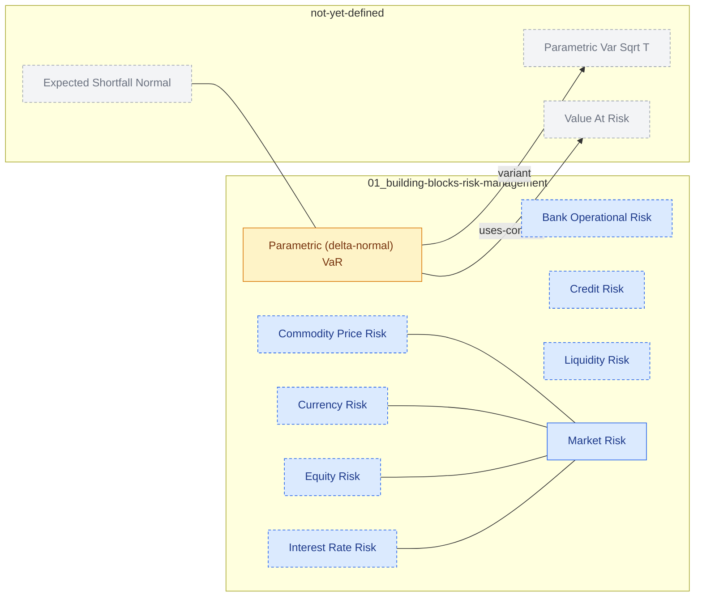

# FRM Concept Graph

<!-- Generated by scripts/build_graph.py. Do not edit by hand. -->

12 nodes, 7 links, 2 with a definition or formula.

Blue = term, green = concept, amber = formula, grey = referenced but not yet defined. Dashed border = definition still missing.

