# FRM Mind Map

<!-- Generated by scripts/build_graph.py. Do not edit by hand. -->

109 nodes, 88 links, 105 with a definition or formula.

Blue = term, green = concept, amber = formula, grey = referenced but not yet defined. Dashed border = definition still missing.

```mermaid
flowchart LR
  subgraph 01_building_blocks_risk_management["01_building-blocks-risk-management"]
    asset_liability_management["Asset/Liability Management"]
    bank_operational_risk["Bank Operational Risk"]
    basel_committee["Basel Committee on Banking Supervision"]
    brainstorming_and_triaging_risks["Brainstorming and Triaging Risks"]
    business_risk["Business Risk"]
    collateralized["Collateralized"]
    commodity_price_risk["Commodity Price Risk"]
    credit_risk["Credit Risk"]
    currency_risk["Currency Risk"]
    default_risk["Default Risk"]
    delta["Delta"]
    downgrade_risk["Downgrade Risk"]
    duration_analysis["Duration Analysis"]
    economic_capital["Economic Capital"]
    equity_risk["Equity Risk"]
    expected_loss["Expected Loss"]
    expected_shortfall["Expected Shortfall"]
    exposure_at_default["Exposure at Default"]
    extreme_value_theory["Extreme Value Theory"]
    funding_liquidity_risk["Funding Liquidity Risk"]
    gap_analysis["Gap Analysis"]
    general_market_risk["General Market Risk"]
    herstatt_risk["Herstatt Risk"]
    interest_rate_risk["Interest Rate Risk"]
    key_performance_indicator["Key Performance Indicator"]
    key_risk_indicator["Key Risk Indicator"]
    liquidity_risk["Liquidity Risk"]
    loss_given_default["Loss Given Default"]
    market_liquidity_risk["Market Liquidity Risk"]
    market_risk["Market Risk"]
    operational_risk["Operational Risk"]
    parametric_var["Parametric (delta-normal) VaR"]
    probability_of_default["Probability of Default"]
    raroc["Risk-Adjusted Return on Capital"]
    reputation_risk["Reputation Risk"]
    reverse_stress_testing["Reverse Stress Testing"]
    risk_aggregation["Risk Aggregation"]
    risk_capital_allocation["Risk Capital Allocation"]
    risk_management_building_blocks["Risk Management Building Blocks"]
    risk_management_process["Risk Management Process"]
    risk_versus_uncertainty["Risk versus Uncertainty"]
    specific_market_risk["Specific Market Risk"]
    strategic_risk["Strategic Risk"]
    stress_testing["Stress Testing"]
    tail_risk["Tail Risk"]
    theta["Theta"]
    three_lines_of_defense["Three Lines of Defense"]
    typology_of_risks["Typology of Risks and Risk Interactions"]
    unexpected_loss["Unexpected Loss"]
    value_at_risk["Value at Risk"]
  end
  subgraph 02_how_firms_manage_financial_risk["02_how-firms-manage-financial-risk"]
    collar["Collar"]
    corporate_hedging_pitfalls["What Can Go Wrong with Corporate Hedging"]
    derivatives_market["Derivatives Market"]
    forward_contract["Forward Contract"]
    futures_contract["Futures Contract"]
    hedging_philosophy["Hedging Philosophy"]
    interest_rate_and_fx_risk_management["Interest Rate and Foreign Exchange Risk Management"]
    modern_imperative_to_manage_risk["The Modern Imperative to Manage Risk"]
    natural_hedge["Natural Hedge"]
    notional_value["Notional Value"]
    option["Option"]
    over_the_counter["Over-the-Counter"]
    rightsizing_risk_management["Rightsizing Risk Management"]
    risk_appetite["Risk Appetite"]
    risk_capacity["Risk Capacity"]
    risk_management_roadmap["Risk Management Roadmap"]
    risk_management_strategy_selection["Strategy Selection: Retain, Avoid, Mitigate, Transfer"]
    risk_mapping["Risk Mapping"]
    risk_transfer_toolbox["Risk Transfer Toolbox"]
    swap["Swap"]
  end
  subgraph 03_governance_risk_management["03_governance-risk-management"]
    audit_committee["Audit Committee"]
    basel_accords_evolution["Evolution of the Basel Accords"]
    basel_i["Basel I"]
    basel_ii["Basel II"]
    basel_iii["Basel III"]
    basel_iii_macroprudential_overlay["Basel III Macroprudential Overlay"]
    comply_or_explain["Comply or Explain"]
    comprehensive_capital_analysis_and_review["Comprehensive Capital Analysis and Review"]
    consumer_financial_protection_bureau["Consumer Financial Protection Bureau"]
    countercyclical_capital_buffer["Countercyclical Capital Buffer"]
    dodd_frank_act["Dodd-Frank Act"]
    dodd_frank_act_reforms["Dodd-Frank Act Reforms"]
    dodd_frank_act_stress_test["Dodd-Frank Act Stress Test"]
    dodd_frank_stress_testing["Dodd-Frank Stress Testing Approach"]
    eba_stress_test["EBA Stress Test"]
    european_regulatory_response["European Regulatory Response to the GFC"]
    fundamental_review_of_the_trading_book["Fundamental Review of the Trading Book"]
    global_financial_crisis_causes["Causes of the 2007-2009 Financial Crisis"]
    gramm_leach_bliley_act["Gramm-Leach-Bliley Act"]
    internal_capital_adequacy_assessment_process["Internal Capital Adequacy Assessment Process"]
    internal_liquidity_adequacy_assessment_process["Internal Liquidity Adequacy Assessment Process"]
    leverage_ratio["Leverage Ratio"]
    liquidity_coverage_ratio["Liquidity Coverage Ratio"]
    living_will["Living Will"]
    net_stable_funding_ratio["Net Stable Funding Ratio"]
    orderly_liquidation_authority["Orderly Liquidation Authority"]
    post_crisis_regulatory_response["Post-Crisis Regulatory Response"]
    risk_governance["Risk Governance"]
    risk_governance_infrastructure["Infrastructure of Risk Governance"]
    sarbanes_oxley_act["Sarbanes-Oxley Act"]
    sox_key_provisions["Sarbanes-Oxley Key Provisions"]
    supervisory_review_and_evaluation_process["Supervisory Review and Evaluation Process"]
    systemically_important_financial_institution["Systemically Important Financial Institution"]
    systemically_important_markets_and_infrastructures["Systemically Important Markets and Infrastructures"]
    tier_1_capital["Tier 1 Capital"]
    total_loss_absorbing_capital["Total Loss-Absorbing Capital"]
    volcker_rule["Volcker Rule"]
  end
  subgraph not_yet_defined["not-yet-defined"]
    expected_shortfall_normal["Expected Shortfall Normal"]
    parametric_var_sqrt_t["Parametric Var Sqrt T"]
  end
  asset_liability_management --- duration_analysis
  asset_liability_management --- funding_liquidity_risk
  asset_liability_management --- gap_analysis
  audit_committee --- sarbanes_oxley_act
  bank_operational_risk --- basel_committee
  bank_operational_risk --- operational_risk
  bank_operational_risk --- risk_capital_allocation
  basel_committee --- basel_i
  basel_committee --- basel_ii
  basel_committee --- basel_iii
  basel_i --- basel_ii
  basel_ii --- basel_iii
  basel_iii --- fundamental_review_of_the_trading_book
  basel_iii --- liquidity_coverage_ratio
  basel_iii --- net_stable_funding_ratio
  basel_iii --- tier_1_capital
  business_risk --- strategic_risk
  collar --- option
  collateralized --- credit_risk
  commodity_price_risk --- futures_contract
  commodity_price_risk --- market_risk
  comply_or_explain --- sarbanes_oxley_act
  comprehensive_capital_analysis_and_review --- dodd_frank_act
  comprehensive_capital_analysis_and_review --- dodd_frank_act_stress_test
  comprehensive_capital_analysis_and_review --- eba_stress_test
  comprehensive_capital_analysis_and_review --- stress_testing
  comprehensive_capital_analysis_and_review --- tier_1_capital
  consumer_financial_protection_bureau --- dodd_frank_act
  credit_risk --- default_risk
  credit_risk --- downgrade_risk
  credit_risk --- exposure_at_default
  credit_risk --- herstatt_risk
  credit_risk --- loss_given_default
  credit_risk --- probability_of_default
  currency_risk --- market_risk
  currency_risk --- natural_hedge
  default_risk --- probability_of_default
  delta --- option
  delta --- theta
  derivatives_market --- forward_contract
  derivatives_market --- futures_contract
  derivatives_market --- option
  derivatives_market --- swap
  dodd_frank_act --- dodd_frank_act_stress_test
  dodd_frank_act --- living_will
  dodd_frank_act --- orderly_liquidation_authority
  dodd_frank_act --- systemically_important_financial_institution
  dodd_frank_act --- volcker_rule
  dodd_frank_act_stress_test --- stress_testing
  eba_stress_test --- stress_testing
  eba_stress_test --- supervisory_review_and_evaluation_process
  economic_capital --- raroc
  economic_capital --- risk_capital_allocation
  economic_capital --- unexpected_loss
  equity_risk --- market_risk
  expected_loss --- exposure_at_default
  expected_loss --- loss_given_default
  expected_loss --- probability_of_default
  expected_loss --- unexpected_loss
  expected_shortfall --- tail_risk
  expected_shortfall --- value_at_risk
  expected_shortfall_normal --- parametric_var
  exposure_at_default --- loss_given_default
  exposure_at_default --- probability_of_default
  extreme_value_theory --- tail_risk
  forward_contract --- futures_contract
  forward_contract --- over_the_counter
  funding_liquidity_risk --- liquidity_risk
  general_market_risk --- market_risk
  general_market_risk --- specific_market_risk
  interest_rate_risk --- market_risk
  interest_rate_risk --- swap
  internal_capital_adequacy_assessment_process --- internal_liquidity_adequacy_assessment_process
  internal_capital_adequacy_assessment_process --- stress_testing
  internal_capital_adequacy_assessment_process --- supervisory_review_and_evaluation_process
  internal_liquidity_adequacy_assessment_process --- supervisory_review_and_evaluation_process
  key_performance_indicator --- key_risk_indicator
  liquidity_coverage_ratio --- net_stable_funding_ratio
  liquidity_risk --- market_liquidity_risk
  living_will --- systemically_important_financial_institution
  loss_given_default --- probability_of_default
  market_risk --- specific_market_risk
  option --- theta
  over_the_counter --- systemically_important_markets_and_infrastructures
  parametric_var -->|variant| parametric_var_sqrt_t
  parametric_var -->|uses-concept| value_at_risk
  reverse_stress_testing --- stress_testing
  risk_appetite --- risk_capacity
  classDef term fill:#dbeafe,stroke:#2563eb,color:#1e3a8a
  classDef concept fill:#dcfce7,stroke:#16a34a,color:#14532d
  classDef formula fill:#fef3c7,stroke:#d97706,color:#78350f
  classDef missing fill:#f3f4f6,stroke:#9ca3af,color:#6b7280,stroke-dasharray:4 3
  classDef incomplete stroke-dasharray:4 3
  class asset_liability_management,audit_committee,bank_operational_risk,basel_committee,basel_i,basel_ii,basel_iii,business_risk,collar,collateralized,commodity_price_risk,comply_or_explain,comprehensive_capital_analysis_and_review,consumer_financial_protection_bureau,countercyclical_capital_buffer,credit_risk,currency_risk,default_risk,delta,derivatives_market,dodd_frank_act,dodd_frank_act_stress_test,downgrade_risk,duration_analysis,eba_stress_test,economic_capital,equity_risk,expected_loss,expected_shortfall,exposure_at_default,extreme_value_theory,forward_contract,fundamental_review_of_the_trading_book,funding_liquidity_risk,futures_contract,gap_analysis,general_market_risk,gramm_leach_bliley_act,herstatt_risk,interest_rate_risk,internal_capital_adequacy_assessment_process,internal_liquidity_adequacy_assessment_process,key_performance_indicator,key_risk_indicator,leverage_ratio,liquidity_coverage_ratio,liquidity_risk,living_will,loss_given_default,market_liquidity_risk,market_risk,natural_hedge,net_stable_funding_ratio,notional_value,operational_risk,option,orderly_liquidation_authority,over_the_counter,probability_of_default,reputation_risk,reverse_stress_testing,risk_capacity,risk_capital_allocation,sarbanes_oxley_act,specific_market_risk,strategic_risk,stress_testing,supervisory_review_and_evaluation_process,swap,systemically_important_financial_institution,systemically_important_markets_and_infrastructures,tail_risk,theta,tier_1_capital,total_loss_absorbing_capital,unexpected_loss,volcker_rule term
  class basel_accords_evolution,basel_iii_macroprudential_overlay,brainstorming_and_triaging_risks,corporate_hedging_pitfalls,dodd_frank_act_reforms,dodd_frank_stress_testing,european_regulatory_response,global_financial_crisis_causes,hedging_philosophy,interest_rate_and_fx_risk_management,modern_imperative_to_manage_risk,post_crisis_regulatory_response,raroc,rightsizing_risk_management,risk_aggregation,risk_appetite,risk_governance,risk_governance_infrastructure,risk_management_building_blocks,risk_management_process,risk_management_roadmap,risk_management_strategy_selection,risk_mapping,risk_transfer_toolbox,risk_versus_uncertainty,sox_key_provisions,three_lines_of_defense,typology_of_risks,value_at_risk concept
  class parametric_var formula
  class expected_shortfall_normal,parametric_var_sqrt_t missing
  class bank_operational_risk,currency_risk incomplete
```

